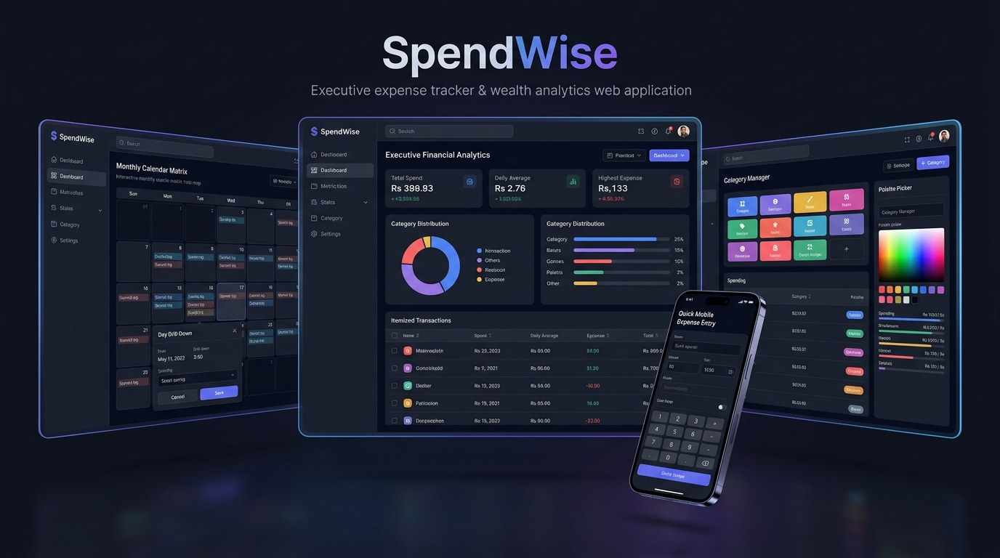

# SpendWise - Executive Expense Tracker & Wealth Analytics



SpendWise is a responsive, high-performance personal finance and expense analytics web application. Built with React 19, Tailwind CSS v4, and Supabase (PostgreSQL), SpendWise delivers an executive dashboard experience with real-time financial tracking, interactive monthly calendar views, dynamic category management, hybrid offline persistence, and automated Excel reporting.

---

## Key Features

### Executive Financial Analytics
- Monthly spend totals, daily averages, transaction volume, and highest expense identification.
- Real-time category allocation breakdown with visual percentage distributions.
- Fast month-by-month pagination and historical review.

### Interactive Daily Expense Calendar
- Monthly calendar matrix displaying daily spending aggregate tags.
- Dynamic color heat mapping based on relative daily expenditure thresholds.
- Day-level drill-down modal to inspect, review, and delete individual daily transactions.

### Category Management
- Custom category creation with preset and custom color palettes.
- Per-category spending summary, including transaction count and total amount spent.
- Category deletion safeguards with database cascading rules (`ON DELETE SET NULL`).

### Financial Reporting and Excel Export
- Native `.xlsx` workbook generation powered by SheetJS (`xlsx`).
- Structured multi-section export including:
  1. Executive Summary block (period, generation timestamp, totals, averages).
  2. Category Breakdown table (transaction count, total spent, percentage share).
  3. Itemized Transaction Log (serial number, date, category, notes, amount).
- Formatted column dimensions for presentation-ready spreadsheets.

### Hybrid Cloud and Offline Architecture
- Cloud synchronization via Supabase PostgreSQL backend.
- Automated fallback to browser `localStorage` when offline or when database credentials are not configured.
- UI status indicator informing the user whether the app is running in Cloud or Local Storage mode.

### Search and Filtering
- Instant, multi-field search query filtering across notes and descriptions.
- Dynamic category filter pills with active state indicators.

### User Interface and Experience
- Dark glassmorphic design system using CSS backdrop filters and refined color palettes.
- Fully responsive layout optimized for desktop, tablet, and mobile displays.
- Mobile slide-over drawer for rapid expense entry on smaller screens.
- Indian Rupee (`Rs.`) formatting with localized digit grouping (`en-IN`).

---

## Technology Stack

- **Frontend Framework:** React 19 (Hooks, Suspense, State Management)
- **Build Tool:** Vite 8
- **Styling:** Tailwind CSS v4 with custom CSS glassmorphic tokens
- **Database & Backend:** Supabase (PostgreSQL)
- **Spreadsheet Generation:** SheetJS (`xlsx`)
- **Iconography:** Lucide React
- **Linter:** Oxlint

---

## Project Architecture

```
expense-tracker/
├── index.html                  # HTML entry point with typography imports
├── package.json                # Project dependencies and operational scripts
├── vite.config.js              # Vite configuration with React and Tailwind plugins
├── .env.example                # Template for environment variables
├── src/
│   ├── main.jsx                # React application bootstrapping
│   ├── App.jsx                 # Main application dashboard and view controller
│   ├── DailyExpenseCalendar.jsx# Monthly calendar grid and day drill-down modal
│   ├── CategoryManager.jsx     # Category CRUD and allocation analytics
│   ├── excelExport.js          # SheetJS workbook generation utility
│   ├── supabase.js             # Supabase client initialization
│   └── index.css               # Global styles, animations, and glassmorphic utility classes
└── public/
    └── favicon.svg             # Application favicon asset
```

---

## Database Schema (PostgreSQL / Supabase)

To set up the database, execute the following SQL script in the Supabase SQL Editor:

```sql
-- Categories Table
create table if not exists categories (
  id bigint generated always as identity primary key,
  name text not null unique,
  color text not null default '#94a3b8'
);

-- Expenses Table
create table if not exists expenses (
  id bigint generated always as identity primary key,
  spent_on date not null default current_date,
  amount numeric(12,2) not null check (amount > 0),
  category_id bigint references categories(id) on delete set null,
  note text,
  created_at timestamptz not null default now()
);

-- Indexes for performance
create index if not exists expenses_spent_on_idx on expenses (spent_on desc);
create index if not exists expenses_category_id_idx on expenses (category_id);

-- Seed Default Categories
insert into categories (name, color) values
  ('Food & Dining', '#f59e0b'),
  ('Transport', '#3b82f6'),
  ('Housing & Utilities', '#ef4444'),
  ('Shopping & Apparel', '#ec4899'),
  ('Entertainment', '#8b5cf6'),
  ('Health & Fitness', '#10b981'),
  ('Work & Education', '#6366f1'),
  ('Miscellaneous', '#64748b')
on conflict (name) do nothing;
```

---

## Getting Started

### Prerequisites

Ensure you have the following installed on your development machine:
- Node.js (v18.0.0 or higher recommended)
- npm (v9.0.0 or higher) or compatible package manager (pnpm, yarn)

### Installation

1. Clone the repository to your local system:
   ```bash
   git clone https://github.com/your-username/expense-tracker.git
   cd expense-tracker
   ```

2. Install project dependencies:
   ```bash
   npm install
   ```

3. Configure Environment Variables:
   Create a `.env` file in the project root by copying the template:
   ```bash
   cp .env.example .env
   ```
   Open `.env` and fill in your Supabase connection parameters:
   ```env
   VITE_SUPABASE_URL=https://your-project-id.supabase.co
   VITE_SUPABASE_ANON_KEY=your-anon-public-key
   ```
   *Note: If the Supabase credentials are left empty or unreachable, the application will automatically fall back to Local Storage mode.*

4. Launch the local development server:
   ```bash
   npm run dev
   ```
   Open your browser and navigate to `http://localhost:5173`.

---

## Available Scripts

In the project root, you can execute:

| Command | Description |
|---|---|
| `npm run dev` | Runs the Vite development server with Hot Module Replacement (HMR). |
| `npm run build` | Compiles and optimizes assets into the `dist/` production folder. |
| `npm run preview` | Serves the production build locally for verification. |
| `npm run lint` | Runs Oxlint to analyze code quality and potential errors. |

---

## Offline Fallback Mechanism

SpendWise provides zero-setup local resilience:
- If Supabase environment variables are missing, connection fails, or the device is offline, the app switches to Local Storage mode.
- Categories are persisted under the key `spendwise_local_categories`.
- Expenses are persisted under the key `spendwise_local_expenses`.
- Users retain full ability to create, edit, view, delete transactions, and export reports in offline mode.

---

## Excel Financial Report Format

The exported `.xlsx` file includes three formatted tables:

1. **Executive Summary:** Overview containing statement period, report generation timestamp, total spend, daily average, and transaction count.
2. **Category Breakdown Summary:** Grouped category metrics displaying category name, transaction count, total spent in Rs, and percentage share.
3. **Itemized Transaction Log:** Chronological table listing S.No, Date, Category Name, Description/Note, and Amount in Rs.

---

## License

This project is open source and available under the [MIT License](LICENSE).
